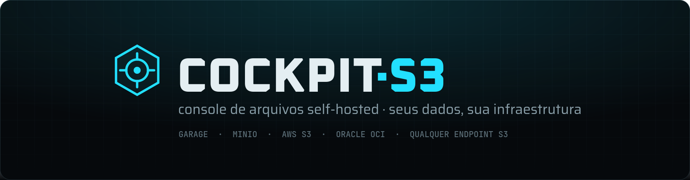
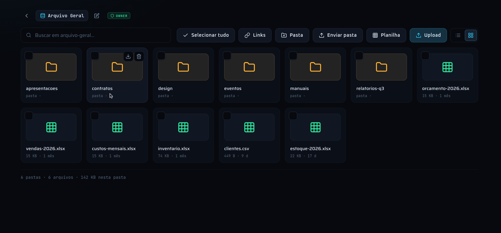
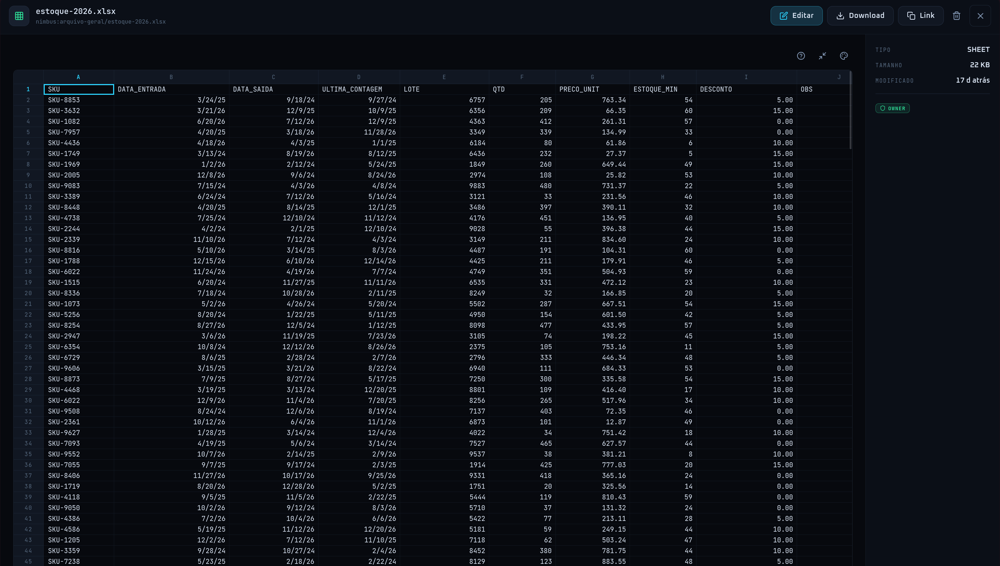
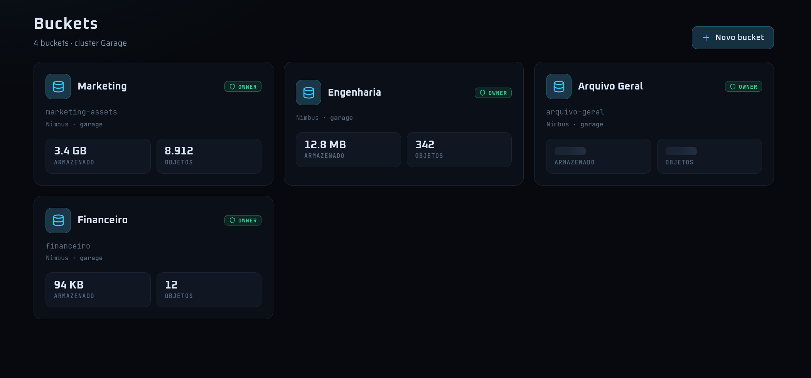
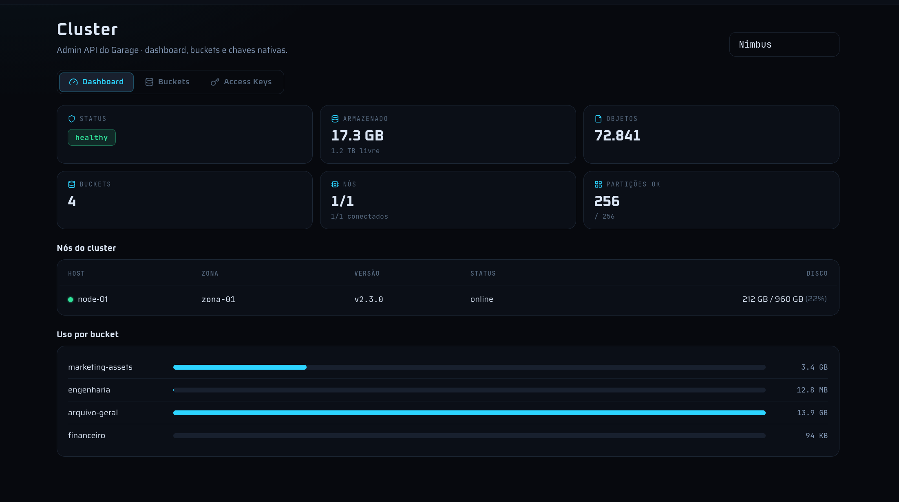

<div align="center">



<h3>Self-hosted web console for any S3 bucket: users, permissions, expiring share links and audit log. Unlimited users.</h3>

Works with Garage, MinIO, AWS S3, Hetzner Object Storage, Backblaze B2, Wasabi, Oracle OCI and any other S3-compatible endpoint.<br>
One Docker container, embedded SQLite, runs on your own infrastructure.

<br>

[](./LICENSE)
[](./COMMERCIAL-LICENSE.md)
[](https://bun.sh)
[](https://vuejs.org)
[](#-quickstart)

**Demo** (coming soon) · [**Docs**](./docs/README.md) · [**Pricing**](#pricing) · [**Cloud waitlist**](mailto:cockpits3@pm.me?subject=Cloud%20waitlist) · [**Enterprise: talk to us**](mailto:cockpits3@pm.me?subject=Enterprise)

English · [Português (Brasil)](./README.pt-BR.md)

</div>

<br>

<p align="center">
  
</p>

> [!NOTE]
> The user interface is currently in Portuguese (Brazil). Menu names are given in this documentation with the Portuguese label in parentheses, e.g. **Settings (Configurações)**.

## Contents

[Quickstart](#-quickstart) · [Why](#-why) · [Comparison](#-comparison) · [Features](#-features) · [Security](#-security) · [Editions & pricing](#pricing) · [Development](#-development) · [Deploy](#-deploy) · [FAQ](#-faq) · [License](#-license)

## 🚀 Quickstart

Multi-arch images (amd64, arm64) are published to the GitHub Container Registry:

```bash
docker run -d --name cockpit-s3 -p 3000:3000 \
  -e ACCESS_TOKEN_SECRET=$(openssl rand -hex 32) \
  -e COOKIE_SECURE=false \
  -v cockpit_data:/data \
  ghcr.io/pagliarinilucas/cockpit-s3:latest
docker logs cockpit-s3   # the initial admin password is printed here
```

Open http://localhost:3000, log in as `admin`, then add your bucket under **Settings (Configurações) → New connection (Nova conexão)**.

- `COOKIE_SECURE=false` is only for plain HTTP on localhost. Behind HTTPS, leave it at the default (`true`).
- Everything the console stores (users, permissions, connections, audit log) lives in the SQLite file in the `/data` volume.
- To build it yourself: `docker build -t cockpit-s3 .`
- With Docker Compose: `cp .env.example .env`, set `ACCESS_TOKEN_SECRET`, then `docker compose up -d --build`. A production compose file with a healthcheck is in [`deploy/compose/`](./deploy/compose/docker-compose.yml).
- Per-provider setup (endpoint, region, least-privilege keys): [`docs/quickstart/`](./docs/quickstart/).

## 🧭 Why

- **The MinIO Console lost its admin features.** In May 2025 the MinIO Community Edition console was reduced to an object browser; user, policy and configuration management moved out of the community UI. In February 2026 the MinIO community repository was archived. Teams that relied on the console to give people access to buckets need a replacement. See [Migrating from the MinIO Console](./docs/migrating-from-minio-console.md).
- **Garage users need more than an admin panel.** Garage is a solid, lightweight S3 server, and the existing web UIs focus on administering the cluster. Giving 20 people scoped access to folders, sharing a file with a partner for 48 hours, and knowing who downloaded what is a different job.
- **Per-user pricing does not fit file sharing.** Every external partner becomes a paid seat in most tools. Cockpit S3 has no per-user limit in any edition.

## 🆚 Comparison

| | **Cockpit S3** | MinIO Console (CE, post-2025) | garage-webui | Filestash | Nextcloud |
| --- | --- | --- | --- | --- | --- |
| What it is | S3 console with users, permissions and sharing | Object browser bundled with MinIO | Admin UI for Garage | Generic file manager for many backends | Full collaboration suite |
| Storage backends | Any S3-compatible | MinIO | Garage | S3 and many others | S3 and others (External Storage) |
| Multi-user permissions managed in the UI | ✅ Per bucket and per folder, groups | ❌ Removed from the CE console | ❌ Single admin login | Paid tiers (RBAC); free Hobby tier up to 3 users | ✅ |
| Expiring public share links | ✅ 1h–30d, lock to first IP, revocation | Presigned URLs only | ❌ | ✅ | ✅ |
| "View but not download" level | ✅ | ❌ | ❌ | — | — |
| Audit log | ✅ In the UI (export in Pro) | ❌ | ❌ | Paid tiers | Via the admin audit app (log file) |
| Garage cluster dashboard | ✅ | — | ✅ | ❌ | ❌ |
| Encryption at rest done by the console | ✅ Per bucket | Server-side SSE (via KMS/KES) | ❌ | — | ✅ Server-side encryption module |
| Footprint | 1 container, SQLite | Part of MinIO server | 1 container | 1 container | PHP app + database (+ Redis recommended) |
| Pricing model | Free (AGPL), unlimited users; paid Pro/Enterprise per instance | Free (AGPL), community repo archived | Free, open source | Free Hobby; paid tiers | Free; Enterprise subscription with a 100-user minimum |

<sub>As of October 2026, based on public documentation; check vendors' sites before deciding. "—" means not applicable or not verified. Corrections are welcome via issue.</sub>

## ✨ Features

**Access control**
- Unlimited users and groups.
- Permission matrix user × bucket with four levels, plus per-folder overrides. Every request is authorized on the server, per object key.

  | Level | Can do |
  | --- | --- |
  | `view-only` | Preview in the browser. No download: the button is hidden and the API refuses. |
  | `read` | Preview and download. |
  | `write` | Upload, rename, delete. |
  | `owner` | All of the above, and manage the bucket and who can access it. |

**Sharing**
- Public links without login for the recipient, valid from 1 hour to 30 days.
- Optional lock to the first IP that opens the link; revocation at any time.
- Only users an admin has allowed to share can create links, and only for files they can download themselves; a `view-only` user can never produce a download link.

**Files**
- Inline preview of PDF, images, video, audio and text, with navigation across the folder.
- Embedded spreadsheet editor (xlsx) — no download and re-upload.
- Drag-and-drop upload, folders, search, multi-select, ZIP download of folders and selections.

<p align="center">
  
</p>

**Storage and operations**
- Multiple S3 connections in one console.
- Garage Admin API dashboard: cluster health, nodes, partitions, bucket usage, native access keys.
- Encryption at rest per bucket, done by the console before objects reach the bucket.
- Encrypted disaster-recovery backup of the encryption keys and the metadata database to a bucket you choose.
- Audit log of uploads, downloads, deletions, and permission grants/revocations.

<p align="center">
  
  
</p>

**Pro and Enterprise** (license key, same binary): SSO via OIDC ([docs](./docs/sso-oidc.md)), audit export (CSV/JSON/NDJSON) with retention and webhook/syslog forwarding, basic branding, white-label. See [Editions & pricing](#pricing).

## 🔐 Security

| | |
| --- | --- |
| **Authorization** | Enforced server-side on every route, resolved per object key. A user-level block is absolute; otherwise the highest grant covering the key wins. |
| **Authentication** | Passwords hashed with argon2id. Short-lived access JWT (15 min) with a version claim for instant revocation; rotating refresh token in an httpOnly, `SameSite=Strict` cookie, stored only as a hash, with reuse detection that revokes the whole token family. Login rate limiting. |
| **S3 credentials** | Stored in the SQLite database in the data volume, never returned by the API, never needed in environment variables. Downloads and previews are streamed through the console, so the S3 endpoint can stay on a private network. |
| **Encryption at rest** | Optional per bucket. Each object is encrypted by the console with its own key before upload; the bucket only holds opaque blobs with random names. See [`docs/encryption.md`](./docs/encryption.md). |
| **Disaster recovery** | Automatic encrypted backup of the key-encryption key and the database, opened with a recovery code you keep offline. |
| **Licensing** | License keys are verified offline (Ed25519). No phone-home, no telemetry. |

More: [`docs/security.md`](./docs/security.md). To report a vulnerability: [`SECURITY.md`](./SECURITY.md).

<a id="pricing"></a>

## 💳 Editions & pricing

| | **Community** | **Pro** | **Enterprise** |
| --- | --- | --- | --- |
| Price | Free | **US$ 390/year** per production instance (or US$ 39/month). Staging/dev instances free. | From **US$ 1,490/year** |
| License | AGPL-3.0 | Commercial (no AGPL obligations) | Commercial, negotiated terms |
| Users | Unlimited | Unlimited | Unlimited |
| Permission matrix + folder overrides, groups | ✅ | ✅ | ✅ |
| Expiring / IP-locked share links | ✅ | ✅ | ✅ |
| Previews + spreadsheet editor | ✅ | ✅ | ✅ |
| Audit log in the UI | ✅ | ✅ | ✅ |
| Garage admin dashboard, multiple S3 connections | ✅ | ✅ | ✅ |
| Encryption at rest, DR backup | ✅ | ✅ | ✅ |
| Single Docker image, nix flake | ✅ | ✅ | ✅ |
| SSO via OIDC (Google, Microsoft Entra ID, Keycloak, Authentik) | | ✅ | ✅ |
| Audit export (CSV/JSON) with configurable retention, webhook/syslog for SIEM | | ✅ | ✅ |
| Basic branding (logo, colors, share page) | | ✅ | ✅ |
| Email support (2 business days) | | ✅ | ✅ |
| LDAP, advanced link policies (mandatory password, download limit, watermark) | | Coming | Coming |
| Full white-label | | | ✅ |
| SAML / SCIM | | | Built on demand |
| High availability (Postgres, multiple replicas) | | | Roadmap |
| SLA, priority support, invoice/PO payment | | | ✅ |
| MinIO migration help, OEM/redistribution rights | | | ✅ |

**Founder pricing:** Pro at **US$ 190/year, locked for life**, for the first 30 customers.

**Cloud (hosted) — waitlist only, not available yet.** Starter US$ 29/month per workspace (bring your own bucket, unlimited users); Business US$ 79/month (SSO, audit export, branding). Founder Cloud pre-sale: US$ 19/month locked. Join the waitlist by emailing [cockpits3@pm.me](mailto:cockpits3@pm.me?subject=Cloud%20waitlist) with the subject "Cloud waitlist".

**How to buy:** online checkout is not live yet. Email [cockpits3@pm.me](mailto:cockpits3@pm.me?subject=Cockpit%20S3%20Pro) with your company name and the number of production instances; you receive an invoice and a license key. Activation and expiry rules: [`docs/licensing.md`](./docs/licensing.md). Terms summary: [`COMMERCIAL-LICENSE.md`](./COMMERCIAL-LICENSE.md).

## 🧱 Architecture

```
cockpit-s3/
├── web/              Vue 3 + Vite + TypeScript SPA
├── api/              Elysia + Bun API (auth, S3, SQLite)
├── packages/sheet/   xlsx parsing shared by API and browser
├── landing/          static landing page
├── deploy/           compose, Coolify, Dokploy, Railway notes
├── docs/             documentation
├── Dockerfile        builds the SPA and runs the API serving it
└── docker-compose.yml
```

In production the API serves the built SPA on the same origin: one port, one volume, one container.

## 💻 Development

Requirements: [Bun](https://bun.sh) 1.x. On NixOS (or with Nix), `nix develop` gives a shell with Bun, Node 22 and the library path that `sodium-native` needs.

```bash
bun run install:all

# terminal 1 — API on :3000
cd api && cp .env.example .env && bun run dev

# terminal 2 — web on :4200 (proxies /api → :3000)
cd web && bun run dev
```

Open http://localhost:4200. On first boot an admin is created from `ADMIN_USERNAME` / `ADMIN_PASSWORD` in `api/.env` (blank password → a random one is printed in the log).

```bash
bun run typecheck       # sheet + api + web
bun run test            # sheet + api + web
bun run license:audit   # regenerates docs/dependency-licenses.md
```

See [`CONTRIBUTING.md`](./CONTRIBUTING.md), [`api/README.md`](./api/README.md) and [`web/README.md`](./web/README.md).

## 🚢 Deploy

Templates and notes for Docker Compose, Coolify, Dokploy and Railway are in [`deploy/`](./deploy/README.md). The Dokploy steps:

<details>
<summary><b>Dokploy A) Compose (recommended — uses <code>docker-compose.yml</code>)</b></summary>

1. **Create → Compose**, pointing to this repository (branch + root path `/`).
2. **Environment** — add at least:
   ```
   ACCESS_TOKEN_SECRET=<openssl rand -hex 32>
   COOKIE_SECURE=true
   ADMIN_USERNAME=admin
   ADMIN_PASSWORD=<a strong password>
   ```
3. **Domains** — add your domain → service `cockpit-s3`, **port `3000`**, HTTPS on. Dokploy's proxy terminates TLS, which is why `COOKIE_SECURE=true` is correct.
4. **Deploy.** The `cockpit_data` volume keeps the database.

</details>

<details>
<summary><b>Dokploy B) Application (Dockerfile)</b></summary>

1. **Create → Application**, this repository, **Build type: Dockerfile** (root `Dockerfile`).
2. Add the same environment variables.
3. Add a **Volume** with mount path `/data` so the SQLite database persists.
4. **Domain** → port `3000`, HTTPS on. Deploy.

</details>

> [!IMPORTANT]
> - **`ACCESS_TOKEN_SECRET` is required in production.** The API exits on boot if it is missing or shorter than 32 characters. Do not reuse the development one.
> - **`COOKIE_SECURE=true`** is required behind HTTPS because the refresh-token cookie is only sent over TLS.
> - **Backups:** snapshot the `/data` volume (`cockpit.sqlite`), and enable the encrypted DR backup if you use encryption at rest.
> - S3 connections are configured in the UI and stored in the database; no S3 credentials go into environment variables.

## ❓ FAQ

<details>
<summary><b>Do I need to know S3 to use it?</b></summary>
<br>
No. An admin connects the storage once in the UI. After that, users drag, drop, preview and share; S3 stays behind the scenes.
</details>

<details>
<summary><b>Does it work with MinIO and AWS S3?</b></summary>
<br>
Yes. Any S3-compatible endpoint: Garage, MinIO, AWS S3, Hetzner, Backblaze B2, Wasabi, Oracle OCI. You can manage several connections at once. The console uses path-style requests, which all of these support.
</details>

<details>
<summary><b>I have no server or storage. What now?</b></summary>
<br>
A hosted Cockpit S3 Cloud is planned but not available yet. Join the waitlist by emailing <b>cockpits3@pm.me</b> with the subject "Cloud waitlist". You would still bring your own bucket (e.g. Hetzner, B2, Wasabi).
</details>

<details>
<summary><b>What about backups?</b></summary>
<br>
Your files stay in your object storage; there is no proprietary silo. Back up the bucket as you normally would. The console's own state is one SQLite file in <code>/data</code>. If you use encryption at rest, enable the automatic encrypted DR backup of the keys and the database to a destination you choose, and keep the recovery code offline.
</details>

<details>
<summary><b>Are files encrypted?</b></summary>
<br>
They can be. Enable encryption at rest per bucket (the bucket must be empty when you turn it on). Each file is then encrypted by the console with its own key before it is written; the bucket only holds unreadable blobs with random names. For users with access in the console, preview and download work as usual.
</details>

<details>
<summary><b>How many users does it support?</b></summary>
<br>
No per-user licensing in any edition. Paid editions are priced per production instance.
</details>

<details>
<summary><b>How do expiring links work?</b></summary>
<br>
A user with the share permission creates a public link for a file they can download. The recipient does not need an account. You choose the validity (1 hour to 30 days) and can lock the link to the first IP that opens it. Links can be revoked at any time.
</details>

<details>
<summary><b>Is there a mobile app?</b></summary>
<br>
No. The web UI is responsive and works on a phone for checking and sharing files.
</details>

<details>
<summary><b>Is it hard to operate?</b></summary>
<br>
One container, an embedded SQLite database, no external services. It runs on any host with Docker.
</details>

<details>
<summary><b>Does the license key phone home?</b></summary>
<br>
No. Keys are signed with Ed25519 and verified offline by the instance. See <a href="./docs/licensing.md"><code>docs/licensing.md</code></a>.
</details>

## 📄 License

Cockpit S3 is dual-licensed:

- **[AGPL-3.0-or-later](./LICENSE)** — free. If you modify it and offer it to users over a network, you must make your modified source available to them.
- **Commercial license** — for organizations that cannot accept AGPL obligations, or that need Pro/Enterprise features, support, or redistribution rights. See [`COMMERCIAL-LICENSE.md`](./COMMERCIAL-LICENSE.md) and [`docs/licensing.md`](./docs/licensing.md).

Copyright © 2026 Lucas Pagliarini. Contributions require signing the [CLA](./CLA.md). Contact: **cockpits3@pm.me**.
