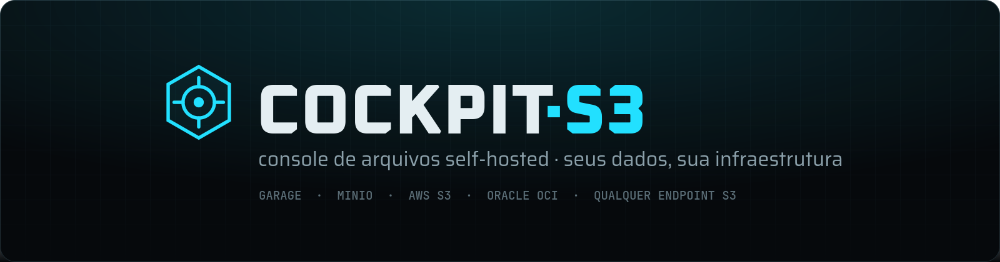
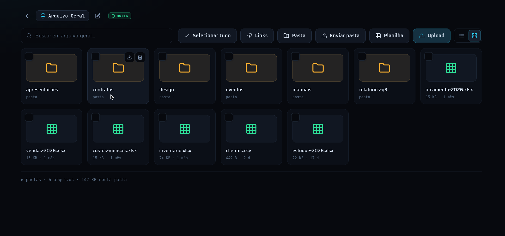
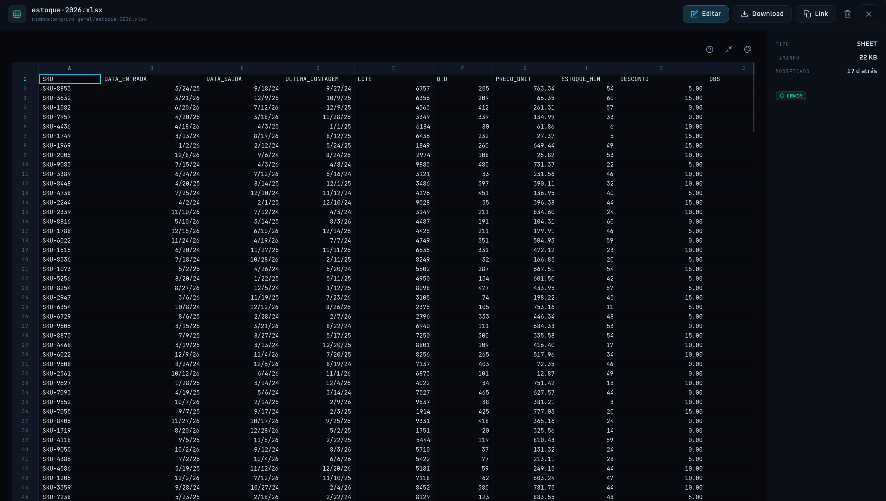
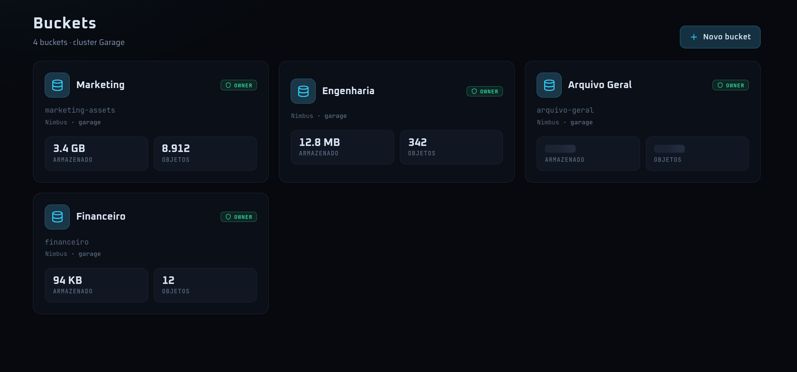
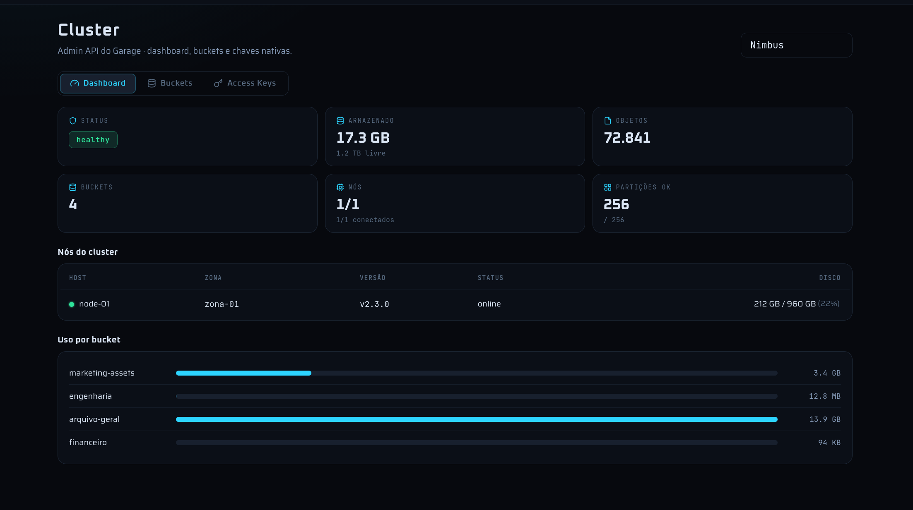

<div align="center">



<h3>Console web self-hosted para qualquer bucket S3: usuários, permissões, links que expiram e auditoria. Usuários ilimitados.</h3>

Funciona com Garage, MinIO, AWS S3, Hetzner Object Storage, Backblaze B2, Wasabi, Oracle OCI e qualquer endpoint compatível com S3.<br>
Um container Docker, SQLite embutido, roda na sua infraestrutura.

<br>

[](./LICENSE)
[](./COMMERCIAL-LICENSE.md)
[](https://bun.sh)
[](https://vuejs.org)
[](#-início-rápido)

**Demo** (em breve) · [**Docs**](./docs/README.md) (em inglês) · [**Preços**](#pricing) · [**Lista de espera Cloud**](mailto:cockpits3@pm.me?subject=Cloud%20waitlist) · [**Enterprise: fale conosco**](mailto:cockpits3@pm.me?subject=Enterprise)

[English](./README.md) · Português (Brasil)

</div>

<br>

<p align="center">
  
</p>

## Conteúdo

[Início rápido](#-início-rápido) · [Por quê](#-por-quê) · [Comparativo](#-comparativo) · [Recursos](#-recursos) · [Segurança](#-segurança) · [Edições e preços](#pricing) · [Desenvolvimento](#-desenvolvimento) · [Deploy](#-deploy) · [FAQ](#-perguntas-frequentes) · [Licença](#-licença)

## 🚀 Início rápido

Imagens multi-arquitetura (amd64, arm64) são publicadas no GitHub Container Registry:

```bash
docker run -d --name cockpit-s3 -p 3000:3000 \
  -e ACCESS_TOKEN_SECRET=$(openssl rand -hex 32) \
  -e COOKIE_SECURE=false \
  -v cockpit_data:/data \
  ghcr.io/pagliarinilucas/cockpit-s3:latest
docker logs cockpit-s3   # a senha inicial do admin aparece aqui
```

Abra http://localhost:3000, entre como `admin` e cadastre seu bucket em **Configurações → Nova conexão**.

- `COOKIE_SECURE=false` serve só para HTTP puro em localhost. Atrás de HTTPS, deixe o padrão (`true`).
- Tudo o que o console guarda (usuários, permissões, conexões, auditoria) fica no SQLite do volume `/data`.
- Para buildar você mesmo: `docker build -t cockpit-s3 .`
- Com Docker Compose: `cp .env.example .env`, defina `ACCESS_TOKEN_SECRET` e rode `docker compose up -d --build`. Um compose de produção com healthcheck está em [`deploy/compose/`](./deploy/compose/docker-compose.yml).
- Configuração por provedor (endpoint, região, chaves com privilégio mínimo): [`docs/quickstart/`](./docs/quickstart/).

## 🧭 Por quê

- **O MinIO Console perdeu as funções de administração.** Em maio de 2025 o console da edição Community do MinIO virou apenas um navegador de objetos; gestão de usuários, políticas e configuração saiu da interface comunitária. Em fevereiro de 2026 o repositório comunitário do MinIO foi arquivado. Quem usava o console para dar acesso a buckets precisa de um substituto. Veja [Migrando do MinIO Console](./docs/migrating-from-minio-console.md).
- **Quem usa Garage precisa de mais que um painel de admin.** O Garage é um servidor S3 leve e sólido, e as interfaces web existentes focam em administrar o cluster. Dar a 20 pessoas acesso restrito a pastas, compartilhar um arquivo com um parceiro por 48 horas e saber quem baixou o quê é outro trabalho.
- **Preço por usuário não combina com compartilhamento de arquivos.** Cada parceiro externo vira uma licença na maioria das ferramentas. O Cockpit S3 não limita usuários em nenhuma edição.

## 🆚 Comparativo

| | **Cockpit S3** | MinIO Console (CE, pós-2025) | garage-webui | Filestash | Nextcloud |
| --- | --- | --- | --- | --- | --- |
| O que é | Console S3 com usuários, permissões e compartilhamento | Navegador de objetos embutido no MinIO | Interface de admin do Garage | Gerenciador de arquivos genérico, vários backends | Suíte completa de colaboração |
| Backends | Qualquer S3 compatível | MinIO | Garage | S3 e vários outros | S3 e outros (External Storage) |
| Permissões multiusuário na interface | ✅ Por bucket e por pasta, grupos | ❌ Removido do console CE | ❌ Um login de admin | Planos pagos (RBAC); Hobby grátis até 3 usuários | ✅ |
| Links públicos que expiram | ✅ 1h–30d, trava por IP, revogação | Só URLs pré-assinadas | ❌ | ✅ | ✅ |
| Nível "ver sem baixar" | ✅ | ❌ | ❌ | — | — |
| Auditoria | ✅ Na interface (exportação no Pro) | ❌ | ❌ | Planos pagos | Via app de auditoria (arquivo de log) |
| Painel de cluster Garage | ✅ | — | ✅ | ❌ | ❌ |
| Criptografia em repouso feita pelo console | ✅ Por bucket | SSE no servidor (via KMS/KES) | ❌ | — | ✅ Módulo de criptografia no servidor |
| Peso | 1 container, SQLite | Parte do servidor MinIO | 1 container | 1 container | App PHP + banco (+ Redis recomendado) |
| Modelo de preço | Grátis (AGPL), usuários ilimitados; Pro/Enterprise pagos por instância | Grátis (AGPL), repositório comunitário arquivado | Grátis, open source | Hobby grátis; planos pagos | Grátis; assinatura Enterprise com mínimo de 100 usuários |

<sub>Em outubro de 2026, com base em documentação pública; confira os sites dos fornecedores antes de decidir. "—" significa não se aplica ou não verificado. Correções são bem-vindas via issue.</sub>

## ✨ Recursos

**Controle de acesso**
- Usuários e grupos ilimitados.
- Matriz de permissões usuário × bucket com quatro níveis, mais ajuste fino por pasta. Toda requisição é autorizada no servidor, por chave de objeto.

  | Nível | O que pode fazer |
  | --- | --- |
  | `só ver` | Visualiza no navegador. Sem download: o botão some e a API recusa. |
  | `leitura` | Visualiza e baixa. |
  | `escrita` | Envia, renomeia e exclui. |
  | `dono` | Tudo isso, e gerencia o bucket e quem tem acesso a ele. |

**Compartilhamento**
- Links públicos sem login para quem recebe, com validade de 1 hora a 30 dias.
- Trava opcional no primeiro IP que abrir o link; revogação a qualquer momento.
- Só usuários autorizados pelo admin a compartilhar geram links, e só de arquivos que eles mesmos podem baixar; um usuário `só ver` nunca gera link de download.

**Arquivos**
- Preview inline de PDF, imagem, vídeo, áudio e texto, com navegação pela pasta.
- Editor de planilhas (xlsx) embutido — sem baixar e reenviar.
- Upload por arrastar e soltar, pastas, busca, seleção múltipla, download em ZIP de pastas e seleções.

<p align="center">
  
</p>

**Storage e operação**
- Várias conexões S3 no mesmo console.
- Painel da Admin API do Garage: saúde do cluster, nós, partições, uso por bucket, chaves nativas.
- Criptografia em repouso por bucket, feita pelo console antes de o objeto chegar ao bucket.
- Backup de recuperação (DR) cifrado das chaves de criptografia e do banco de metadados para um bucket à sua escolha.
- Auditoria de envio, download, exclusão e de concessão/revogação de acesso.

<p align="center">
  
  
</p>

**Pro e Enterprise** (chave de licença, mesmo binário): SSO via OIDC ([docs](./docs/sso-oidc.md)), exportação da auditoria (CSV/JSON/NDJSON) com retenção e envio por webhook/syslog, branding básico, white-label. Veja [Edições e preços](#pricing).

## 🔐 Segurança

| | |
| --- | --- |
| **Autorização** | Validada no servidor em toda rota, resolvida por chave de objeto. Bloqueio por usuário é absoluto; fora isso vale a maior permissão que cobre a chave. |
| **Autenticação** | Senhas com argon2id. Access JWT curto (15 min) com claim de versão para revogação instantânea; refresh token rotativo em cookie httpOnly `SameSite=Strict`, guardado só como hash, com detecção de reuso que revoga a família inteira. Rate-limit de login. |
| **Credenciais S3** | Guardadas no SQLite do volume de dados, nunca devolvidas pela API, nunca em variável de ambiente. Downloads e previews passam pelo console, então o endpoint S3 pode ficar em rede privada. |
| **Criptografia em repouso** | Opcional por bucket. Cada objeto é cifrado pelo console com chave própria antes do envio; o bucket só guarda blocos ilegíveis com nomes aleatórios. Veja [`docs/encryption.md`](./docs/encryption.md). |
| **Recuperação (DR)** | Backup automático e cifrado da KEK e do banco, aberto com um código de recuperação que você guarda offline. |
| **Licenciamento** | Chaves verificadas offline (Ed25519). Sem phone-home, sem telemetria. |
| **LGPD e soberania** | Dados na sua infraestrutura, sob sua jurisdição. |

Mais: [`docs/security.md`](./docs/security.md). Para reportar uma vulnerabilidade: [`SECURITY.md`](./SECURITY.md).

<a id="pricing"></a>

## 💳 Edições e preços

| | **Community** | **Pro** | **Enterprise** |
| --- | --- | --- | --- |
| Preço | Grátis | **US$ 390/ano** por instância de produção (ou US$ 39/mês). Instâncias de staging/dev grátis. | A partir de **US$ 1.490/ano** |
| Licença | AGPL-3.0 | Comercial (sem obrigações da AGPL) | Comercial, termos negociados |
| Usuários | Ilimitados | Ilimitados | Ilimitados |
| Matriz de permissões + ajuste por pasta, grupos | ✅ | ✅ | ✅ |
| Links que expiram / travados por IP | ✅ | ✅ | ✅ |
| Previews + editor de planilhas | ✅ | ✅ | ✅ |
| Auditoria na interface | ✅ | ✅ | ✅ |
| Painel do Garage, várias conexões S3 | ✅ | ✅ | ✅ |
| Criptografia em repouso, backup DR | ✅ | ✅ | ✅ |
| Imagem Docker única, nix flake | ✅ | ✅ | ✅ |
| SSO via OIDC (Google, Microsoft Entra ID, Keycloak, Authentik) | | ✅ | ✅ |
| Exportação da auditoria (CSV/JSON) com retenção configurável, webhook/syslog para SIEM | | ✅ | ✅ |
| Branding básico (logo, cores, página de compartilhamento) | | ✅ | ✅ |
| Suporte por email (2 dias úteis) | | ✅ | ✅ |
| LDAP, políticas avançadas de link (senha obrigatória, limite de downloads, marca d'água) | | Em breve | Em breve |
| White-label completo | | | ✅ |
| SAML / SCIM | | | Sob demanda |
| Alta disponibilidade (Postgres, várias réplicas) | | | Roadmap |
| SLA, suporte prioritário, pagamento por fatura/PO | | | ✅ |
| Ajuda na migração do MinIO, direitos de OEM/redistribuição | | | ✅ |

**Preço de fundador:** Pro a **US$ 190/ano, travado para sempre**, para os 30 primeiros clientes.

**Cloud (hospedado) — só lista de espera, ainda não disponível.** Starter US$ 29/mês por workspace (traga seu bucket, usuários ilimitados); Business US$ 79/mês (SSO, exportação de auditoria, branding). Pré-venda de fundador Cloud: US$ 19/mês travado. Entre na lista mandando email para [cockpits3@pm.me](mailto:cockpits3@pm.me?subject=Cloud%20waitlist) com o assunto "Cloud waitlist".

**Como comprar:** o checkout online ainda não está no ar. Escreva para [cockpits3@pm.me](mailto:cockpits3@pm.me?subject=Cockpit%20S3%20Pro) com o nome da empresa e o número de instâncias de produção; você recebe a fatura e a chave de licença. Ativação e regras de expiração: [`docs/licensing.md`](./docs/licensing.md). Resumo dos termos: [`COMMERCIAL-LICENSE.md`](./COMMERCIAL-LICENSE.md).

## 🧱 Arquitetura

```
cockpit-s3/
├── web/              SPA em Vue 3 + Vite + TypeScript
├── api/              API em Elysia + Bun (auth, S3, SQLite)
├── packages/sheet/   leitura de xlsx compartilhada entre API e navegador
├── landing/          landing page estática
├── deploy/           compose, Coolify, Dokploy, Railway
├── docs/             documentação
├── Dockerfile        builda o SPA e sobe a API servindo-o
└── docker-compose.yml
```

Em produção a API serve o SPA buildado na mesma origem: uma porta, um volume, um container.

## 💻 Desenvolvimento

Requisito: [Bun](https://bun.sh) 1.x. No NixOS (ou com Nix), `nix develop` entrega um shell com Bun, Node 22 e o library path que o `sodium-native` precisa.

```bash
bun run install:all

# terminal 1 — API em :3000
cd api && cp .env.example .env && bun run dev

# terminal 2 — web em :4200 (proxy de /api → :3000)
cd web && bun run dev
```

Abra http://localhost:4200. No primeiro boot é criado um admin a partir de `ADMIN_USERNAME` / `ADMIN_PASSWORD` em `api/.env` (senha em branco → uma aleatória é impressa no log).

```bash
bun run typecheck       # sheet + api + web
bun run test            # sheet + api + web
bun run license:audit   # regera docs/dependency-licenses.md
```

Veja [`CONTRIBUTING.md`](./CONTRIBUTING.md), [`api/README.md`](./api/README.md) e [`web/README.md`](./web/README.md).

## 🚢 Deploy

Templates e notas para Docker Compose, Coolify, Dokploy e Railway estão em [`deploy/`](./deploy/README.md). Passo a passo do Dokploy:

<details>
<summary><b>Dokploy A) Compose (recomendado — usa o <code>docker-compose.yml</code>)</b></summary>

1. **Create → Compose**, apontando para este repo (branch + root path `/`).
2. **Environment** — adicione no mínimo:
   ```
   ACCESS_TOKEN_SECRET=<openssl rand -hex 32>
   COOKIE_SECURE=true
   ADMIN_USERNAME=admin
   ADMIN_PASSWORD=<uma senha forte>
   ```
3. **Domains** — adicione seu domínio → serviço `cockpit-s3`, **porta `3000`**, HTTPS ligado. O proxy do Dokploy termina o TLS (por isso `COOKIE_SECURE=true` está correto).
4. **Deploy.** O volume `cockpit_data` persiste o banco.

</details>

<details>
<summary><b>Dokploy B) Application (Dockerfile)</b></summary>

1. **Create → Application**, este repo, **Build type: Dockerfile** (`Dockerfile` da raiz).
2. Adicione as mesmas variáveis de ambiente.
3. Adicione um **Volume** com mount path `/data` (para o SQLite persistir).
4. **Domain** → porta `3000`, HTTPS ligado. Deploy.

</details>

> [!IMPORTANT]
> - **`ACCESS_TOKEN_SECRET` é obrigatório em produção** — a API encerra no boot se ele estiver ausente ou tiver menos de 32 caracteres. Não reaproveite o de desenvolvimento.
> - **`COOKIE_SECURE=true`** é necessário atrás de HTTPS, porque o cookie do refresh token só trafega por TLS.
> - **Backups:** faça snapshot do volume `/data` (`cockpit.sqlite`) e ative o backup DR cifrado se usar criptografia em repouso.
> - As conexões S3 são configuradas na interface e guardadas no banco; nenhuma credencial S3 vai em variável de ambiente.

## ❓ Perguntas frequentes

<details>
<summary><b>Preciso entender de S3 para usar?</b></summary>
<br>
Não. Um admin conecta o storage uma vez pela interface. A partir daí é arrastar, soltar, visualizar e compartilhar; o S3 fica nos bastidores.
</details>

<details>
<summary><b>Funciona com MinIO e AWS S3?</b></summary>
<br>
Sim. Qualquer endpoint compatível com S3: Garage, MinIO, AWS S3, Hetzner, Backblaze B2, Wasabi, Oracle OCI. Dá para gerenciar várias conexões ao mesmo tempo. O console usa requisições path-style, que todos esses suportam.
</details>

<details>
<summary><b>Não tenho servidor nem storage. E agora?</b></summary>
<br>
Um Cockpit S3 Cloud hospedado está planejado, mas ainda não está disponível. Entre na lista de espera mandando email para <b>cockpits3@pm.me</b> com o assunto "Cloud waitlist". Você continuaria trazendo seu próprio bucket (ex.: Hetzner, B2, Wasabi).
</details>

<details>
<summary><b>E o backup?</b></summary>
<br>
Seus arquivos ficam no seu object storage, sem silo proprietário; faça backup do bucket como de costume. O estado do console é um arquivo SQLite em <code>/data</code>. Se usar criptografia em repouso, ative o backup DR automático e cifrado das chaves e do banco para um destino à sua escolha, e guarde o código de recuperação offline.
</details>

<details>
<summary><b>Os arquivos ficam criptografados?</b></summary>
<br>
Podem ficar. Ative a criptografia em repouso por bucket (o bucket precisa estar vazio na ativação). A partir daí cada arquivo é cifrado pelo console com chave própria antes de ser gravado; no bucket só existem blocos ilegíveis com nomes aleatórios. Para quem tem acesso no console, preview e download seguem normais.
</details>

<details>
<summary><b>Quantos usuários ele suporta?</b></summary>
<br>
Nenhuma edição cobra por usuário. As edições pagas são cobradas por instância de produção.
</details>

<details>
<summary><b>Como funciona o link que expira?</b></summary>
<br>
Um usuário com permissão de compartilhar gera um link público de um arquivo que ele pode baixar. Quem recebe não precisa de conta. Você escolhe a validade (1 hora a 30 dias) e pode travar o link no primeiro IP que abrir. Dá para revogar a qualquer momento.
</details>

<details>
<summary><b>Tem app mobile?</b></summary>
<br>
Não. A interface web é responsiva e funciona bem no celular para conferir e compartilhar arquivos.
</details>

<details>
<summary><b>É difícil de operar?</b></summary>
<br>
Um container, banco SQLite embutido, sem serviços externos. Sobe em qualquer servidor com Docker.
</details>

<details>
<summary><b>A chave de licença liga para algum servidor?</b></summary>
<br>
Não. As chaves são assinadas com Ed25519 e verificadas offline pela própria instância. Veja <a href="./docs/licensing.md"><code>docs/licensing.md</code></a>.
</details>

## 📄 Licença

O Cockpit S3 tem licença dupla:

- **[AGPL-3.0-or-later](./LICENSE)** — grátis. Se você modificar e oferecer o software a usuários pela rede, precisa disponibilizar a eles o código-fonte modificado.
- **Licença comercial** — para quem não pode aceitar as obrigações da AGPL ou precisa dos recursos Pro/Enterprise, suporte ou direitos de redistribuição. Veja [`COMMERCIAL-LICENSE.md`](./COMMERCIAL-LICENSE.md) (em inglês, com nota em português no final) e [`docs/licensing.md`](./docs/licensing.md).

Copyright © 2026 Lucas Pagliarini. Contribuições exigem a assinatura do [CLA](./CLA.md). Contato: **cockpits3@pm.me**.
